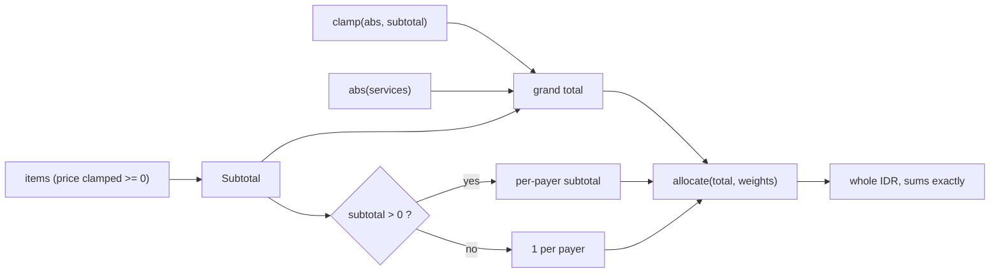

# Split Calculation

Lives in `src/lib/billing/calculate.ts` as `calculateTotals(payers, discount, service)`. Receipt renders it directly: `const totals = $derived(calculateTotals($biling, discount, services))`. Pure and node-runnable, so `test/billing.test.ts` exercises it without a browser.

```ts
subtotal     = sum(max(item.price ?? 0, 0))
discount     = min(abs(discount ?? 0), subtotal)   // clamped, never -0
service      = abs(services ?? 0)
grandTotal   = subtotal - discount + service
weights      = subtotal > 0 ? perPayerSubtotal : 1 each
personTotal  = allocate(grandTotal, weights)[i]
personFee    = allocate(service, weights)[i]
personDisc   = -allocate(discount, weights)[i]
```

`allocate` is a largest-remainder allocator: floor each `total * weight / sum`, then hand the leftover units to the largest fractional parts. Receipt amounts are whole IDR, so per-person values must sum **exactly** to the grand total. Plain `grandTotal * share` does not: on subtotal 200_000 with a 10_000 fee it printed 69_999 + 70_000 + 70_000 = 209_999 against a 210_000 header.

## Invariants
- `sum(people.total) === grandTotal`, always. Same for `service` and `discount`.
- All per-person amounts are integers; `allocate` returns whole units, no cents.
- Discount is clamped to the subtotal, so `grandTotal >= 0` and no person total is negative.
- Blank `discount` yields `0`, never `-0` (which `Intl.NumberFormat` renders as `-Rp 0`).
- Subtotal 0 splits evenly across payers instead of dividing by zero into NaN.
- Negative item prices are treated as 0 on input.



## Lesson
Per-person totals include fee and discount proportionally, so a payer's total can differ from their item subtotal. The receipt shows both. Rounding is allocated, not per-person computed — never reintroduce `grandTotal * share`.

Related: [state-store.md](state-store.md), [../ui/receipt-export.md](../ui/receipt-export.md), [../practices.md](../practices.md).
