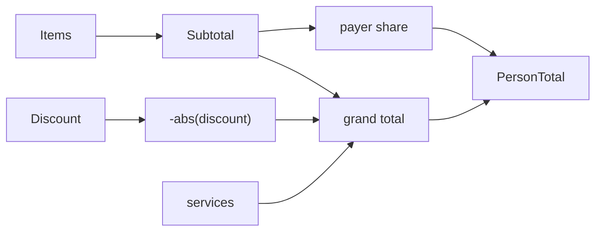

# Split Calculation

Implemented as `$derived` in `src/lib/components/Receipt/Component.svelte`. Not yet extracted to a module.

```ts
trueDiscount = -Math.abs(discount ?? 0)
subtotal     = sum(all item.price ?? 0)
grandTotal   = subtotal + (services ?? 0) + trueDiscount
// per payer
personSub    = sum(payer item price ?? 0)
share        = personSub / subtotal
personTotal  = grandTotal * share
personFee    = services * share
personDisc   = trueDiscount * share
```

## Invariants
- Discount sign is forced negative.
- Shares across payers sum to 1 when subtotal > 0.
- Subtotal 0 gives share NaN. UI prints via `|| 0` fallbacks, so output shows 0, but the math is still NaN internally. Guard before changing.



## Lesson
Per-person totals include fee and discount proportionally, so a payer's total can differ from their item subtotal. The receipt shows both.

Related: [state-store.md](state-store.md), [../ui/receipt-export.md](../ui/receipt-export.md).
