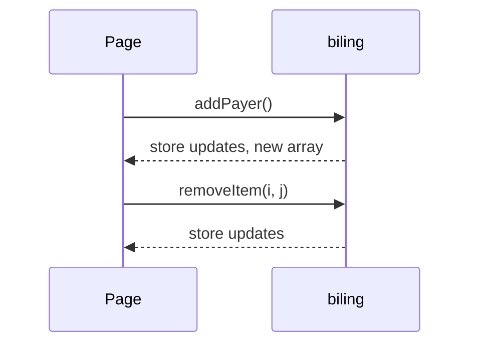

# Billing State Store

Single writable store in `src/lib/store.ts`, exported as `biling` (subscribe/set/update plus mutators).

```ts
export const biling = {
  subscribe, set, update,
  addPayer: () => ...              // appends { name: "", bills: [{ product: "Item 1", price: null }] }
  removePayer: (index) => ...      // splice
  addItem: (index) => ...          // appends { product: "Item N", price: null }
  removeItem: (payer, item) => ... // splice
}
```

## Invariants
- Each new payer starts with one item. UI blocks removing the last item.
- Default item names are `Item <n>`, n = current length + 1. Names are not unique after removals.
- Price `null` = unset.

## Note
`addItem` mutates the existing payer's `bills` in place, then returns a new outer array. Svelte reactivity fires because the outer array is new. Keep this in mind before moving to deep immutability.



Related: [summary.md](summary.md), [split-calculation.md](split-calculation.md), [../practices.md](../practices.md).
