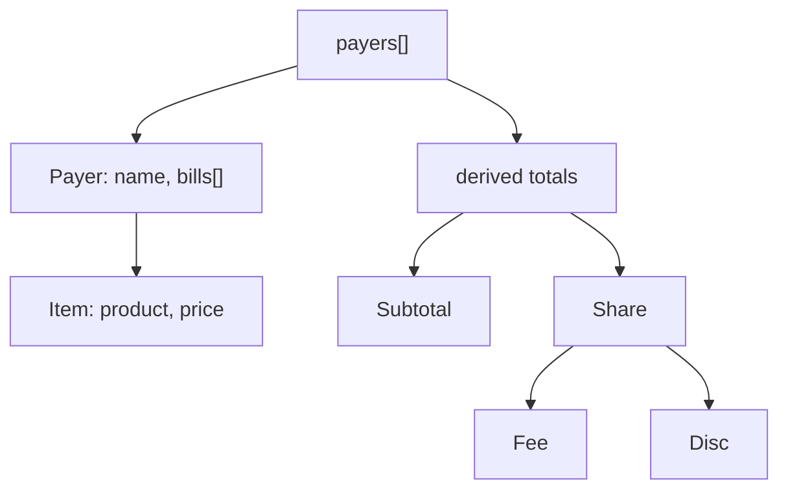

# Billing Domain

Owns payers, items, and all money math. Pure client state, no server.

Files:
- [state-store.md](state-store.md) - store shape and mutations
- [split-calculation.md](split-calculation.md) - `calculateTotals`: allocation, clamping, invariants

Related: [../terminology.md](../terminology.md), [../ui/summary.md](../ui/summary.md).
