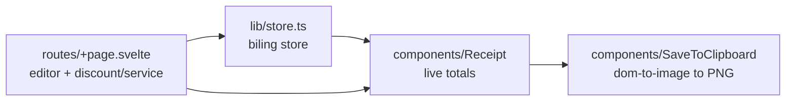

# SplitBill: Summary

Client-only SvelteKit app (Svelte 5 runes, Tailwind, bits-ui) that splits a shared bill among payers. The user adds payers (name) and item rows (product, price in IDR), plus a global discount and service fee. A live receipt shows per-payer totals with proportional fee/discount shares. "Copy Bill" renders the receipt DOM to PNG and writes it to the clipboard. State is one in-memory Svelte store (`src/lib/store.ts`). No backend, no persistence, no auth.

Related: [terminology.md](terminology.md), [practices.md](practices.md), [lode-map.md](lode-map.md), [billing/summary.md](billing/summary.md), [ui/summary.md](ui/summary.md).
