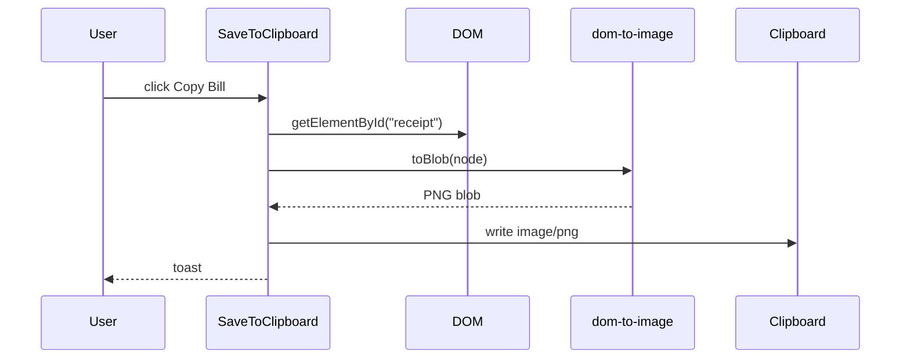

# Receipt Export

`SaveToClipboard` finds `#receipt` in the DOM, renders it with `dom-to-image` `toBlob`, writes a `ClipboardItem` with `image/png`, and shows a sonner toast.

```ts
const node = document.getElementById("receipt")
const blob = await domtoimage.toBlob(node)
navigator.clipboard.write([new ClipboardItem({ "image/png": blob })])
toast("Receipt copied to clipboard", {})
```

## Invariants
- Export targets the element with id `receipt`. Renaming that id breaks export.
- Export captures whatever is rendered, so the receipt must stay in the DOM.

## Known gaps
- Clipboard write promise is not awaited. Success toast shows even if the write fails.



Related: [summary.md](summary.md), [../plans/roadmap.md](../plans/roadmap.md).
