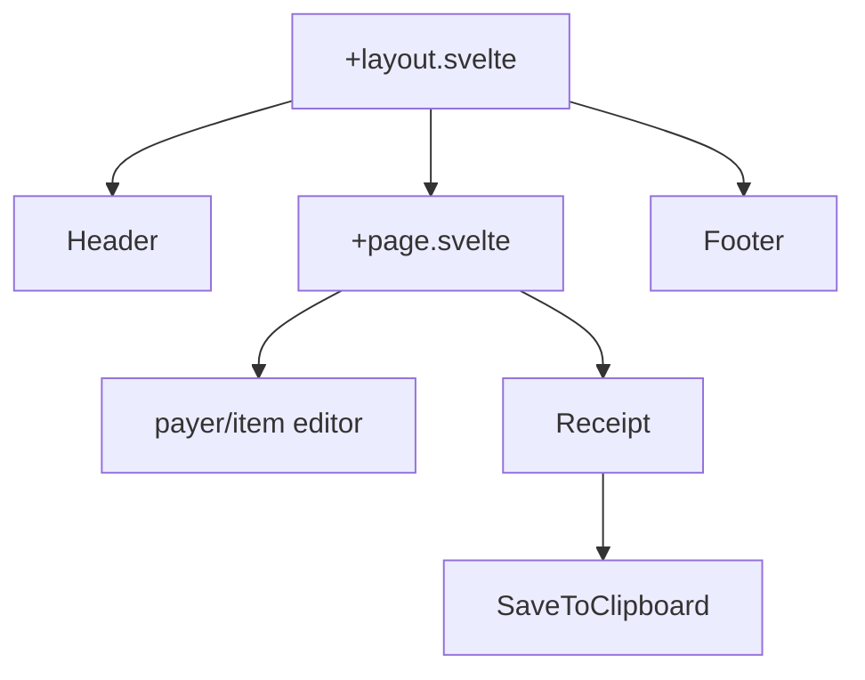

# UI

Routes: `src/routes/+layout.svelte` (Toaster, Header, Footer, SEO head) and `src/routes/+page.svelte` (editor left, receipt right; stacks on mobile).

Components:
- `lib/components/Receipt`: live receipt. Holds no math — delegates to `calculateTotals` and renders `totals`. Owns only the title and clock (`$state`, `onMount` interval).
- `lib/components/SaveToClipboard`: "Copy Bill" button.
- `lib/components/ui/*`: shadcn-style primitives (button, input, label, form parts, sonner).
- `lib/layouts/Header`, `lib/layouts/Footer`.

Page-local state: `discount` and `services` are `$state` in +page.svelte, passed as props to Receipt. Numeric inputs carry `min={0}`, and `calculateTotals` clamps again so a pasted or typed negative still cannot produce a negative receipt.

Related: [receipt-export.md](receipt-export.md), [../billing/summary.md](../billing/summary.md), [../practices.md](../practices.md).
